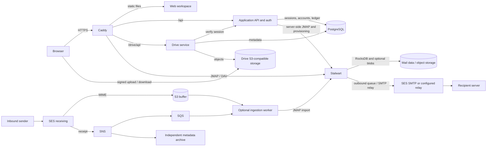

# Architecture and security

The standard target is a single host running Compose. The diagram shows implemented components and intended external paths; configuring the optional worker, relay, provider resources and production storage is an operator task. See [inbound ingestion](ingestion.md) for its current behavior and proof limits and [outbound operations](../operations/outbound.md) for relay configuration. See the [production runbook](../deployment/production.md) for the deployed configuration.

The ingestion queue and archive preserve different evidence; neither acceptance by SES nor a queue acknowledgement proves mailbox visibility or recoverability. Stalwart queues outbound mail; submission and relay acceptance are not final delivery. The local default stores Stalwart data and blobs in RocksDB; S3-compatible mail blobs are optional. Drive uses a separate database and object store. Compose's `dev` profile supplies local AWS substitutes, and `ingest` is an opt-in profile.

## Identity and authorization

Better Auth uses email/password sessions with secure, HTTP-only, SameSite=Lax cookies and optional TOTP and backup codes. Public registration is disabled; an authenticated administrator creates users. The API rechecks the session, enabled user and active mailbox for protected operations. Mail credentials are scoped to the owning user and kept server-side. Administrators can manage domains and disable other accounts subject to safeguards; normal users cannot use administrative procedures. Drive verifies the session with the API and enforces item ownership and shares independently. A public Drive link is a bearer token, stored hashed and checked on each public download.

Web MFA does not protect direct IMAP or SMTP authentication. Keep these protocol ports bound to loopback until managed app passwords are implemented and mail TLS is verified. Vault uses its own account and separately configured two-step login; it does not use the Esuno session.

API requests other than GET and HEAD must carry the configured public `Origin`; the API also trusts only the configured Caddy proxy address. Drive rejects requests to its authenticated command handler marked `Sec-Fetch-Site: cross-site`; its public download and preview routes have separate checks. Do not treat this as a universal Origin check on Drive. Keep the API and Drive behind the intended proxy and validate the boundary for the deployment.

## Mail management isolation and secrets

Caddy replaces forwarded client IPs, blocks requests from the management subnet and routes public mail protocols without exposing the administrative web path. The Stalwart setup job uses a separate management network and IP-restricted account. The mail JMAP endpoint is shared; the proxy does not inspect JMAP request bodies. Any container able to contact Stalwart directly may forge forwarded headers, and Docker administrators can access credentials: these are trusted boundaries. Do not expose management credentials to clients or attach untrusted workloads to internal networks. The API and management helper use the private management account; see [development](../development.md#authentication-and-mailbox-provisioning) for provisioning and [outbound operations](../operations/outbound.md) for the helper.

Compose generates distinct local secrets in a volume, including database passwords, auth secret, mailbox encryption key and Stalwart recovery and management passwords. Mailbox credentials are encrypted in PostgreSQL with the mailbox key. Operator-supplied storage, relay, backup and TLS secrets have separate handling; back up keys and configuration with data and protect Docker access. Losing the mailbox key prevents recovery of stored mailbox credentials. Server-side encryption does not prevent the services or an operator with key access from reading data; Esuno does not claim zero-access or end-to-end encryption. See [backup](../operations/backup.md), [mail object storage](../operations/object-storage.md) and [ADR 0001](../adr/0001-architecture.md).
